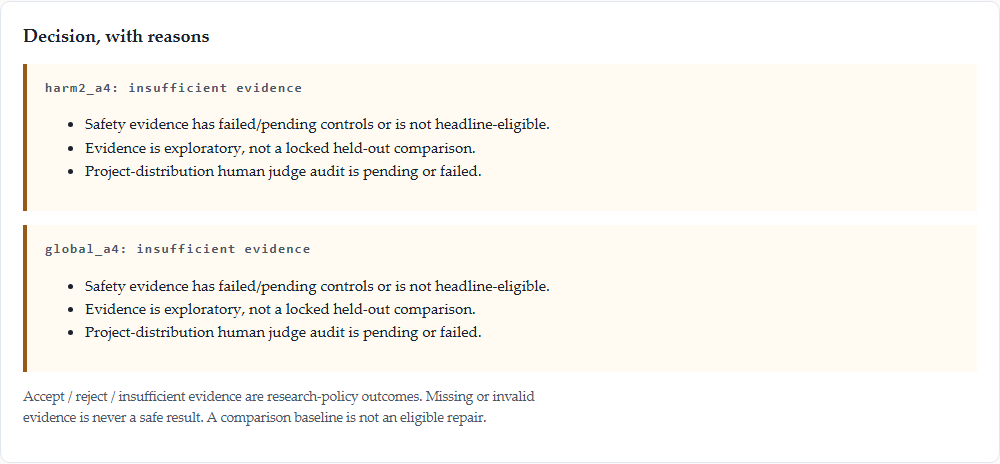

# ScarTissue

An offline workbench for deciding whether a weight-space repair is supported by evidence—or whether the
correct answer is **insufficient evidence**. The case study compares an aligned Cohere Tiny Aya Global
checkpoint, its abliterated counterpart, and sparse/full-support repairs using CuratorKIT, CircuitKIT and
AuditKIT.

**[Open the demo](https://amugoodbad229-scartissue.static.hf.space/)** ·
**[Watch the recorded workflow](results/workbench_demo_20261106.webm)** ·
[Model artifacts](https://huggingface.co/collections/amugoodbad229/scartissue-repair-parameters) ·
[Evaluation evidence](https://huggingface.co/collections/amugoodbad229/scartissue-evaluation-evidence)



## What the demo does

1. Loads a complete evidence bundle with model, revision, split and source hashes.
2. Lets you change harm, over-refusal, utility and intervention-size bounds.
3. Returns **accept**, **reject** or **insufficient evidence**, with machine-readable reasons.
4. Compares all arms and replays the same prompt across their completions and judge verdicts.
5. Exports the decision currently shown on screen. Raw completions stay out of decision exports.

No model runs in the browser. There is no API key, GPU, backend or hosted drifted checkpoint.

## Measured case study

All harm values below are **exploratory**, not confirmatory: the judge panel failed calibration.
Harm-ASR is majority-of-three judge harm; refusal keywords are only a diagnostic. Utility is lm-eval
GSM8K strict-match.

| Arm | Harm-ASR | Benign over-refusal | GSM8K |
|---|---:|---:|---:|
| Aligned base | 0.058 | 0.075 | 0.590 |
| Abliterated drift | 0.217 | 0.050 | 0.560 |
| Sparse repair | 0.050 | 0.175 | 0.518 |
| Full-support repair | 0.042 | 0.275 | 0.438 |

Sparse repair retained more utility than full-support repair in this run: paired GSM8K difference
**+0.080**, 95% bootstrap interval **[0.038, 0.122]**. The measured circuit-restricted arm did **not**
reduce harm relative to drift (0.283 versus 0.217) and has no capability measurement.

These results do not establish a production-safe repair. The controlled intervention is abliteration,
not evidence that task fine-tuning caused drift. The locked held-out confirmatory comparison and a
180-item blind project-distribution human audit are still pending, so every bundled arm correctly
reports **insufficient evidence**.

## Run locally

```bash
# No installation: open space/index.html, or serve the directory:
cd space && python -m http.server 8000

# Reproducible offline checks (requires uv and Node):
uv sync
uv run python -m experiments.verify_submission
```

The verifier checks source and bundle integrity; it does not convert failed calibration into approval.
See [REPRODUCE.md](REPRODUCE.md) for the pinned Modal validation and paid GPU regeneration paths.

## Repository map

| Path | Purpose |
|---|---|
| `space/` | The single static demo, including its evidence bundle and readiness ledger |
| `artifacts/` | Parameter patches and loader; no drifted checkpoint |
| `1-curate/` | Frozen corpus and published fit/evaluation split |
| `experiments/` | Generation, analysis, evidence and validation entry points |
| `results/` | Full completions, judgments, analyses, screenshots and validation records |
| `human_audit/` | Blind audit interface; no labels exported yet |
| `report/` | Historical report source and PDF |
| `_research/` | Protocol, findings, article draft and submission-form draft |

## Submission and status

- **Primary:** Track 2a — red-teaming/robustness evaluation and adversarial/safety evaluation sets.
- **Secondary:** Track 2b — repairing drift without retraining and locating where safety lives; the
  circuit result is explicitly negative.
- **Repositories:** CuratorKIT, CircuitKIT, AuditKIT. SafeTune was not used for the custom rank-one edit.
- **Model:** Tiny Aya Global. “Base” is the unmodified comparison arm, not Tiny Aya Base.

The current submission text is in
[`_research/SUBMISSION-FORM-20261106.md`](_research/SUBMISSION-FORM-20261106.md); the article draft is
[`_research/HF-ARTICLE.md`](_research/HF-ARTICLE.md).

The demo and repository are publishable as exploratory research. The scientific ledger remains
`not_submission_ready` until the human-labelled audit clears the pre-registered calibration gate. The
latest integrity report is
[`results/submission_verification_20261107T143612137007Z.json`](results/submission_verification_20261107T143612137007Z.json).

Only parameter patches are published. Cohere LSAL research-use restrictions prohibit publishing or
deploying the drifted checkpoint.
